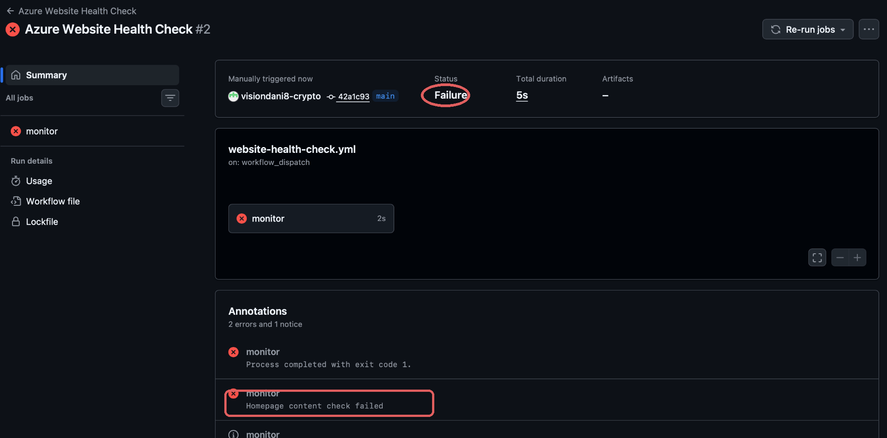
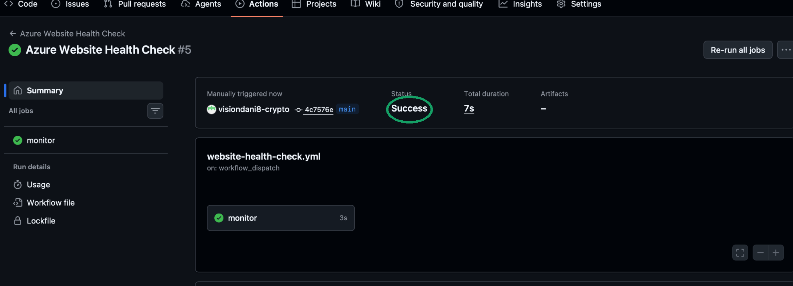

# Azure Cloud Engineering Portfolio — Deploy, Monitor & Secure

**Personal hands-on cloud engineering lab · Microsoft Azure · GitHub Actions · Azure CLI**

This repository demonstrates three connected projects using one Azure Static Web App: **cloud deployment (Project 03)**, **automated website monitoring and incident investigation (Project 04)**, and **least-privilege identity and access management (Project 05)**.

> These are personal learning labs, not client systems or claims of production-scale reliability. Security experiments were performed with temporary identities and cleaned up afterward.

## Project portfolio

| Project | Practical achievement | Full technical evidence |
| --- | --- | --- |
| **03 — Cloud Website Deployment** | Deployed and updated an Azure Static Web App through GitHub Actions CI/CD; troubleshot Azure regional restrictions | [Project 03 full README](readme.md) · [live website](https://polite-smoke-0e690c510.5.azurestaticapps.net) |
| **04 — Cloud Monitoring & Incident Response** | Built automated HTTP/content checks, simulated and diagnosed failures, confirmed GitHub Inbox notifications, and verified successful scheduled runs | **[Project 04 case study](docs/project-04-monitoring.md)** · [incident report](docs/incident-report.md) · [screenshots](evidence/project-04/) |
| **05 — Azure IAM & RBAC Security** | Audited inherited permissions; granted resource-scoped Monitoring Reader to an isolated test principal; demonstrated allowed and denied reads; verified cleanup | [Project 05 security assessment](docs/project-05-iam-rbac.md) |

## Azure architecture

```text
Developer pushes site changes
           |
           v
GitHub repository -> GitHub Actions CI/CD -> Azure Static Web Apps
                                                   |
                                                   v
                                           Public HTTPS website
                                                   ^
                                                   |
                           GitHub Actions health-check workflow
                          (HTTP 200 + expected homepage content)
                              |                         |
                           Pass                      Fail
                                                  -> GitHub Inbox

Cloud security lab: Microsoft Entra test principal
      -> Monitoring Reader on this Static Web App only
      -> ARM resource GET allowed
      -> parent resource-group GET denied
      -> temporary test access and credentials removed
```

## Verified Project 04 monitoring results

- **Manual HTTP test:** HTTP 200; observed response time 0.295582 seconds.
- **Simulated failure:** [Health Check #2](https://github.com/visiondani8-crypto/azure-website-project-03/actions/runs/41207889532) detected a deliberately missing content string (not a website outage).
- **Notification validation:** GitHub Inbox recorded the intentionally failing checks; email alerts were not tested.
- **Recovery check:** [Health Check #5](https://github.com/visiondani8-crypto/azure-website-project-03/actions/runs/41209550079) passed, HTTP 200 and expected content present.
- **Automatic scheduling:** [Run #6](https://github.com/visiondani8-crypto/azure-website-project-03/actions/runs/41243815468), [#7](https://github.com/visiondani8-crypto/azure-website-project-03/actions/runs/41278837027), and [#8](https://github.com/visiondani8-crypto/azure-website-project-03/actions/runs/41310403454) were triggered by `schedule` and succeeded on 31 Oct–1 Nov 2026. GitHub can delay cron starts.

### Project 04 evidence preview

**Simulated failure detection**



**Successful normal monitoring**



See [all five individually viewable screenshots](docs/project-04-monitoring.md#screenshots-and-evidence), including Azure Activity Logs, manual HTTP check, and GitHub Inbox alerts.

## Tools and security practices

- Azure Static Web Apps (Free), Azure Activity Logs and Azure Policy troubleshooting
- GitHub, GitHub Actions and version-controlled workflow configuration
- Bash, Azure CLI, `curl` and Azure Resource Manager REST API
- Microsoft Entra ID, service principals, Azure RBAC and permission inheritance
- Resource-scoped least privilege, isolated authentication, positive/negative access tests
- Temporary credential revocation, RBAC grant removal and test identity cleanup

## Limitations

- HTTP success on individual checks is **not** a continuous availability metric or service-level objective.
- GitHub Actions cron schedules may be delayed and are not an instant paging solution.
- The monitoring failure was simulated by changing the expected content string; the website was not intentionally shut down.
- No long-lived service-principal credentials, subscription IDs, secrets or tokens should be uploaded to this repository.
- Project 05 was a controlled personal security test, not an independent security audit of an organisation.

---

**Explore the projects:** [Deployment](readme.md) · [Monitoring and Incident Response](docs/project-04-monitoring.md) · [IAM/RBAC Security](docs/project-05-iam-rbac.md)
