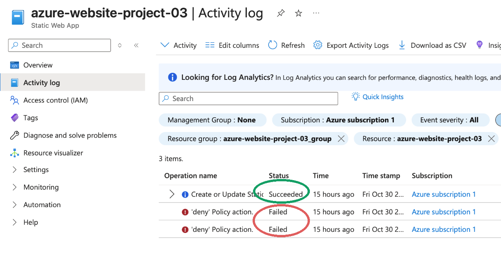
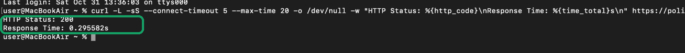
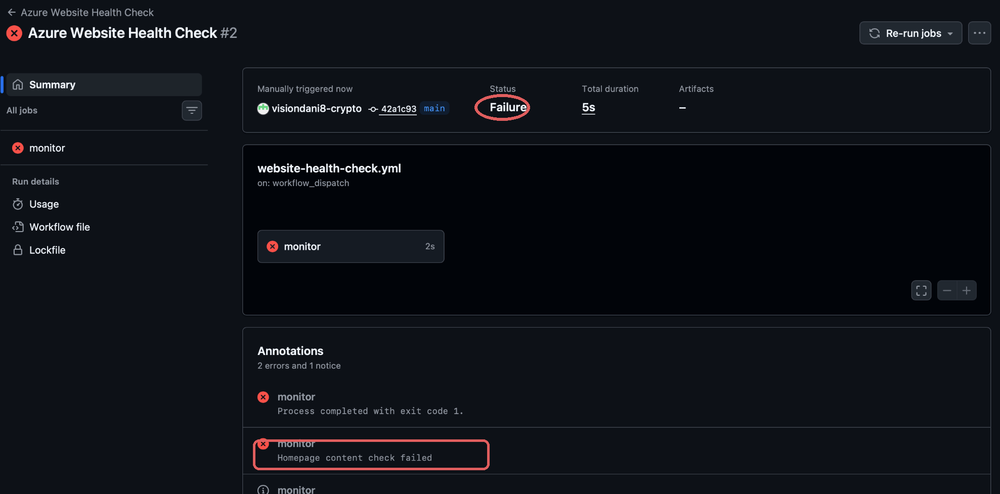
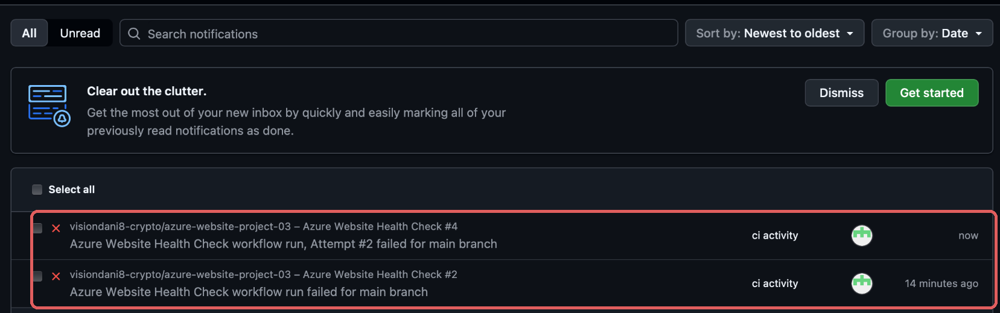
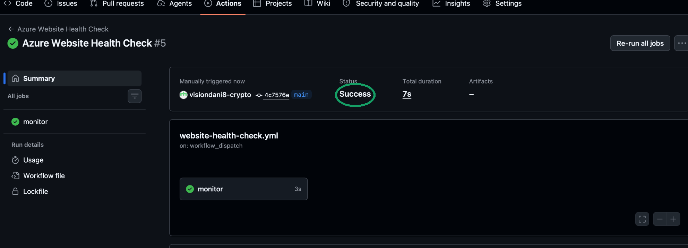

# Project 3 - Azure Website Monitoring & Incident Response

**Project type:** Personal cloud engineering lab · **Date:** 31 October 2026 · **Result:** Manual health checks, automated monitoring, simulated failure detection, GitHub notification and normal monitoring verification completed.

> This project builds on [Project 2 - Azure Static Website Deployment & CI/CD](project-02-deployment.md). It demonstrates monitoring and investigation skills; it is not evidence of 24/7 uptime or a real production outage.

## Objective

Monitor an existing Azure-hosted static website, investigate Azure Activity Log events, detect a controlled failure, validate GitHub notification delivery and document the findings.

**Target URL:** [Azure Cloud Portfolio](https://polite-smoke-0e690c510.5.azurestaticapps.net)

## Architecture

```text
GitHub Actions (manual dispatch or schedule)
                |
                v
curl -> Azure Static Web App (HTTPS)
                |
                v
HTTP status + homepage text validation
          /                \
  Normal check         Simulation mode
   200 + expected      200 + deliberately
   content             missing text string
      |                      |
   PASS                    FAIL
      |                      |
 Workflow success     Workflow error (exit 1)
                             |
                             v
                  GitHub Inbox notification

Azure Activity Log (management plane) -> policy denial analysis
```

## Verified observations

| Test / observation | Evidence | Outcome |
| --- | --- | --- |
| Azure Activity Log | Azure portal, resource `azure-website-project-03` | Successful Static Web App operation; two denied policy events |
| Regional restriction | Policy event JSON, 30 Oct 2026 22:18:25 UTC | `sys.blockwesteurope` enforced a `deny` policy for West Europe |
| Manual HTTP test | Mac Terminal `curl`, 31 Oct 2026 | HTTP 200, 0.295582 seconds (single request) |
| First automated check | [Run #1](https://github.com/visiondani8-crypto/azure-website-project-03/actions/runs/41207541890) | Success |
| Simulated content failure | [Run #2](https://github.com/visiondani8-crypto/azure-website-project-03/actions/runs/41207889532) | Expected failure: homepage content check |
| Normal check after simulation | [Run #3](https://github.com/visiondani8-crypto/azure-website-project-03/actions/runs/41208079533) | Success |
| Notification test | [Run #4](https://github.com/visiondani8-crypto/azure-website-project-03/actions/runs/41208814640), GitHub Inbox | Expected failure produced GitHub notification |
| Final normal health check | [Run #5](https://github.com/visiondani8-crypto/azure-website-project-03/actions/runs/41209550079) | Success, HTTP 200, 0.101846 seconds, expected content present |
| First scheduled health check | [Run #6](https://github.com/visiondani8-crypto/azure-website-project-03/actions/runs/41243815468) | Success, 31 Oct 2026 21:29 UTC |
| Second scheduled health check | [Run #7](https://github.com/visiondani8-crypto/azure-website-project-03/actions/runs/41278837027) | Success, 1 Nov 2026 05:56 UTC |
| Third scheduled health check | [Run #8](https://github.com/visiondani8-crypto/azure-website-project-03/actions/runs/41310403454) | Success, 1 Nov 2026 13:15 UTC |

**Monitoring checks:** HTTP 200, successful network request, and homepage containing `Azure Cloud Portfolio`.

**Failure simulation:** Manual `simulate_failure` input changes the expected text to a deliberately missing string. It does **not** modify or shut down the website. Run #4 verified HTTP 200 while the simulated content check failed.

## Implementation

- **Website:** Azure Static Web Apps Free.
- **Monitoring:** [`.github/workflows/website-health-check.yml`](../.github/workflows/website-health-check.yml).
- **GitHub Actions:** `workflow_dispatch` for manual checks; cron `17 */6 * * *` for scheduled checks (UTC). **Verified:** three scheduled runs (#6, #7, #8) succeeded. GitHub Actions may delay scheduled execution, so start timestamps do not necessarily match the cron minute.
- **Runner:** GitHub-hosted Ubuntu; job timeout set to three minutes.
- **Network resilience:** curl with a five-second connection timeout, a 20-second maximum transfer duration, and two retries.
- **Access:** Workflow uses `contents: read` only; no Azure account keys are required to check a public website.
- **Alerts:** GitHub Inbox notifications observed following failed workflow runs. **Email alert delivery was not tested.**

## Investigation: Azure Policy deployment denial

An Azure Activity Log entry showed a policy event with:
- Operation: `Microsoft.Authorization/policies/deny/action`
- Category: `Policy`; severity `Error`; status `Failed`
- Region: `westeurope`
- Assignment: `sys.blockwesteurope`
- Policy display name: `Resources should not be created in West Europe`

**Root cause:** An Azure policy blocked a deployment in West Europe. Provisioning the Static Web App in a permitted region (Central US) later succeeded. The denial was a resource-management restriction, not a demonstrated website outage.

Avoid publishing complete Azure Activity Log JSON or token/claim payloads. Those may expose account identifiers, IP addresses or authentication metadata.

## Simulated incident report

[Read the controlled incident report](incident-report.md). It documents what the monitoring detected, why the test failed, and how normal monitoring was verified afterward.

## Screenshots and evidence

The five cropped screenshots have been extracted from the [evidence ZIP](../project03_monitoring_evidence.zip) and committed individually to [`evidence/project-03/`](../evidence/project-03/). All five can be reviewed here without downloading an archive. Workflow results are also independently verifiable using the links in the table above.

### 1. Azure Activity Log and policy denials

Shows a successful Static Web App management operation and two policy-denied operations. These are **management-plane events**, not a measure of website availability.



### 2. Manual HTTP check

A single `curl` request returned HTTP 200 with a response time of approximately 296 ms. This is **one measurement**, not an uptime percentage.



### 3. Controlled monitoring failure

An intentionally missing content string made GitHub Actions health check #2 fail. The site itself was **not** intentionally taken offline.



### 4. GitHub notifications

The GitHub Inbox received notifications for deliberately failing workflow runs. Email notifications were not tested.



### 5. Normal monitoring restored

After disabling the simulation, workflow #5 passed. Subsequently, **scheduled** runs #6–#8 also passed.



## Limitations and next improvements

- A successful HTTP response at one moment is **not proof of high availability over time**.
- One page and one expected string provide only basic content validation, not full application monitoring.
- Scheduled runs #6–#8 were confirmed successful; GitHub may still delay scheduled starts or disable schedules after prolonged repository inactivity.
- GitHub Inbox notification is not guaranteed instant incident paging.
- Monitoring currently does not persist response-time history, define an SLO, or perform checks from multiple locations.
- Next improvements: alert thresholds/repeated-failure logic, response-time logging and a dedicated monitoring endpoint.

## What I learned

- Interpret Azure Activity Logs and policy-denial events to identify deployment failures.
- Use `curl` to examine status codes and response times.
- Build a manually triggered and scheduled GitHub Actions health-check workflow.
- Test both passing and intentionally failing scenarios.
- Read workflow logs, distinguish false alarms from real outages and verify recovery.
- Document a technical investigation without exposing credentials.

## CV-ready description

**Azure Website Monitoring & Incident Response — Personal Project (Oct 2026):** Implemented GitHub Actions health checks for an Azure Static Web App, validating HTTP responses and expected page content. Tested simulated failure detection, verified GitHub notifications and successful recovery checks, and investigated an Azure Policy regional deployment restriction using Activity Logs.
