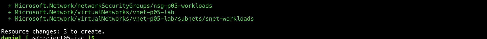
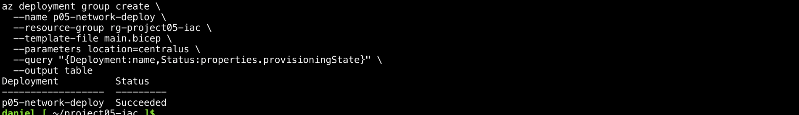
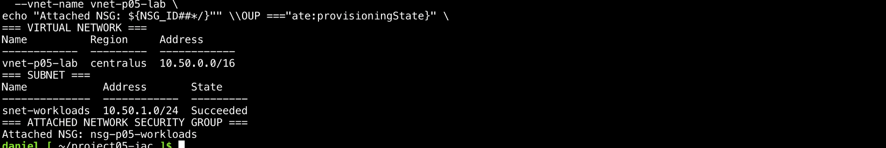
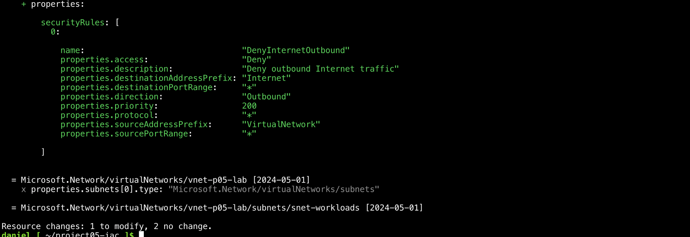
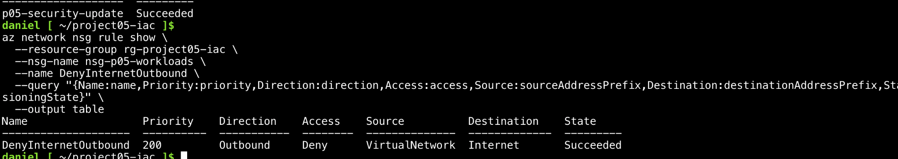
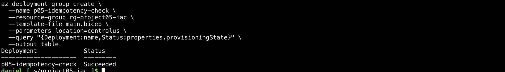
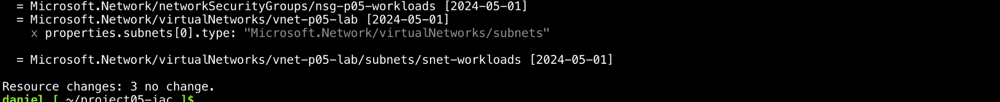
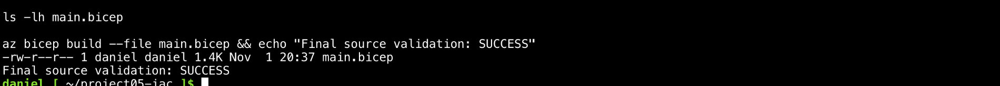

# Project 5 - Azure Infrastructure as Code & Network Security Automation

**Intermediate cloud engineering lab | Microsoft Azure | Bicep | Azure CLI**  
**Status: COMPLETED — 1 November 2026.** Azure Bicep deployment, network-security update, no-change repeat-deployment validation, source publication, eight portfolio evidence screenshots, and isolated lab cleanup were completed and verified.

## Project overview

This hands-on personal project uses **Azure Bicep** to provision a network in an isolated Azure resource group. After the initial deployment, the template was updated with a custom outbound security rule, checked using **Azure What-If**, deployed, and verified. I then reapplied the same template and confirmed that a subsequent What-If detected **no changes**.

**[Inspect the actual Bicep source: `main.bicep`](main.bicep)**

This repository contains the **exact Bicep source file submitted from the completed lab**. The source is declarative and does not require a virtual machine or application backend.

## Architecture

```text
main.bicep (version-controlled infrastructure definition)
    |
    v
Azure CLI + Bicep build
    |
    v
Azure What-If (preview and review changes)
    |
    v
Resource group: rg-project05-iac (Central US)
    |
    +-- Virtual Network: vnet-p05-lab [10.50.0.0/16]
    |     |
    |     +-- Subnet: snet-workloads [10.50.1.0/24]
    |              |
    |              +-- Network Security Group association
    |
    +-- NSG: nsg-p05-workloads
          |
          +-- DenyInternetOutbound
                Priority: 200
                Direction: Outbound
                Source: VirtualNetwork
                Destination: Internet
                Access: Deny
```

There are **no VMs, public IP addresses, load balancers, gateways, or application workloads** in this lab. Thus the NSG rule configuration was verified, but **live packet filtering was not tested**.

## Azure resources and configuration

| Item | Configured value |
| --- | --- |
| Resource group | `rg-project05-iac` |
| Region | `centralus` |
| Bicep target scope | `resourceGroup` |
| Virtual Network | `vnet-p05-lab` |
| VNet address space | `10.50.0.0/16` |
| Subnet | `snet-workloads` |
| Subnet range | `10.50.1.0/24` |
| Network Security Group | `nsg-p05-workloads` |
| Custom rule | `DenyInternetOutbound` |
| Rule priority / action | `200` / `Deny` |
| Rule scope | Outbound from `VirtualNetwork` to `Internet` |
| Resource API version | `2024-05-01` |
| Existing private endpoint policy settings | Explicitly preserved as `Disabled` in template |

## Implementation and validation

| Step | Method | Verified result |
| --- | --- | --- |
| Tool setup | `az bicep install`, `az bicep version` | Bicep v0.48.1 available in Cloud Shell |
| Template compilation | `az bicep build --file main.bicep` | Compilation succeeded |
| Initial deployment preview | `az deployment group what-if` | Three resources predicted for creation |
| First real deployment | `az deployment group create --name p05-network-deploy` | `Succeeded` |
| Post-deployment inspection | `az network vnet show`, `az network vnet subnet show` | Correct address ranges and NSG association |
| Default NSG audit | `az network nsg rule list --include-default` | Six default security rules returned |
| Security modification preview | Full-resource What-If | Detected intended NSG rule addition **and unintended policy-property changes** |
| Drift-prevention correction | Explicit policy settings in Bicep | Final preview: **1 to modify, 2 unchanged** |
| Security policy deployment | `az deployment group create --name p05-security-update` | `Succeeded` |
| Custom rule verification | `az network nsg rule show` | Outbound deny, priority 200, correct tags, `Succeeded` |
| Repeatability preview | What-If before redeployment | 3 resources unchanged |
| Second deployment | `az deployment group create --name p05-idempotency-check` | `Succeeded` |
| Final post-deployment What-If | Full-resource preview | **3 no change** |
| Source-file validation | `az bicep build --file main.bicep` | `Final source validation: SUCCESS` |

**Important distinction:** `what-if` predicts resource differences; it is not a substitute for inspecting actual deployed properties. The repeat deployment and final no-change preview provide stronger evidence of idempotent configuration, although they do not prove every workload-level network behaviour.

## Engineering decision: avoid unintended infrastructure changes

The first full What-If for the security update showed:
- Intended: add `DenyInternetOutbound` to the NSG.
- Unintended: `privateEndpointVNetPolicies` and `privateEndpointNetworkPolicies` property differences.

Rather than deploying immediately, the Bicep template was corrected to **explicitly preserve the observed `Disabled` settings**. A second detailed What-If then returned:
- **1 to modify**: NSG custom security rule.
- **2 no change**: VNet and subnet.

This demonstrates the importance of reviewing infrastructure changes before deployment and treating API defaults and omitted properties carefully.

## Reproduce the lab

**Prerequisites:** Azure subscription with appropriate permissions, `Microsoft.Network` provider registered, Azure CLI and Bicep. Choose a location allowed by subscription policy. Review potential costs before deployment. Commands below create or modify Azure resources.

```bash
# 1. Prepare isolated lab resource group
az group create --name rg-project05-iac --location centralus

# 2. Validate the template offline
az bicep build --file main.bicep

# 3. Preview proposed changes before deployment
az deployment group what-if \
  --resource-group rg-project05-iac \
  --template-file main.bicep \
  --parameters location=centralus \
  --result-format FullResourcePayloads

# 4. Deploy only after reviewing What-If
az deployment group create \
  --name p05-network-deploy \
  --resource-group rg-project05-iac \
  --template-file main.bicep \
  --parameters location=centralus

# 5. Verify infrastructure and security
az network vnet show \
  -g rg-project05-iac -n vnet-p05-lab \
  --query "addressSpace.addressPrefixes" -o table

az network vnet subnet show \
  -g rg-project05-iac --vnet-name vnet-p05-lab \
  -n snet-workloads \
  --query "{Subnet:name,Prefix:addressPrefix,NSG:networkSecurityGroup.id}" -o json

az network nsg rule show \
  -g rg-project05-iac --nsg-name nsg-p05-workloads \
  -n DenyInternetOutbound \
  --query "{Name:name,Priority:priority,Access:access,Direction:direction}" -o table

# 6. Re-run what-if to check for predicted drift
az deployment group what-if \
  -g rg-project05-iac -f main.bicep \
  --result-format FullResourcePayloads
```

This published `main.bicep` is the **final version**, so on a fresh lab its first deployment will include the outbound deny rule. The staged initial deployment and separate rule update documented above were performed interactively during the original lab.

## Security and operational limitations

- The built-in NSG rules still exist. The custom priority-200 rule takes precedence for matching outbound traffic to the Internet service tag.
- `VirtualNetwork` and `Internet` are Azure service tags; they are not exhaustive packet-level allow/deny evidence.
- The exercise did **not** test real traffic, because no VM or other workload was provisioned.
- Default NSG rules permit some other categories of traffic. This is not a blanket deny-all security architecture.
- No deployment automation workflow or continuous drift monitoring has been implemented for this project; deployments were manually initiated through Azure CLI using source-defined Bicep.
- Virtual Networks and NSGs typically have no standalone hourly cost, but other Azure networking services and associated usage may incur charges. Check current Azure pricing and resource usage.
- Cloud Shell sessions are ephemeral, so the source file is preserved here rather than relying on the shell filesystem.

## Evidence and source integrity

**Source code:** [`main.bicep`](main.bicep) — the actual Azure Bicep template supplied after the final successful compilation.

**Verified screenshot evidence:** All eight screenshots were captured from the interactive lab, cropped to remove browser account details and subscription-ID lines, and committed individually to the [Project 5 evidence directory](evidence/). The images are embedded directly below, so employers can inspect the practical deployment results without downloading an archive. The [original redacted ZIP](project5_evidence_redacted.zip) is also retained.

### 1. Initial What-If — three resources planned

Azure What-If predicted creation of a VNet, subnet and NSG before the initial deployment.



### 2. Initial deployment succeeded

Azure CLI reported the first `p05-network-deploy` deployment as `Succeeded`.



### 3. Verify deployed VNet, subnet and NSG

The deployed VNet uses `10.50.0.0/16`, the subnet uses `10.50.1.0/24`, and the intended NSG is attached.



### 4. Review and correct unintended What-If changes

After adding an outbound deny rule, the initial detailed What-If also predicted network-policy property changes. The Bicep source was corrected, and the next preview reported the **NSG to modify and VNet/subnet unchanged**.



### 5. Verify custom security rule in Azure

The deployed `DenyInternetOutbound` rule has priority `200`, direction `Outbound`, destination `Internet`, action `Deny` and state `Succeeded`.



### 6. Repeat deployment succeeded

The repeat `p05-idempotency-check` Azure deployment completed successfully.



### 7. Final What-If — no changes

A final full-payload What-If after redeployment showed **`Resource changes: 3 no change`**. This demonstrates the intended steady state in Azure at the time of validation.



### 8. Actual Bicep source compiles

The final `main.bicep` file was present and compiled successfully using the Azure Bicep CLI.



**Evidence limitations:** Screenshots show the CLI and What-If results, not a packet-level traffic test or continuous drift monitoring. The custom NSG rule was not tested against a live workload. No credentials, tokens or subscription identifiers are intentionally published in these cropped evidence screenshots.

## Safe resource cleanup — verified

**Result: Completed on 1 November 2026.** After publishing the Bicep source and eight screenshots to GitHub, I inspected the isolated Azure resource group `rg-project05-iac` and verified it contained only the disposable Project 5 resources. I validated its `Project=Project05` and `Environment=Lab` tags, then deleted it.

| Cleanup checkpoint | Observed Azure CLI result |
| --- | --- |
| Resource inventory | `nsg-p05-workloads` (NSG) and `vnet-p05-lab` (VNet), both in Central US; subnet contained within VNet |
| Expected lab tags | Passed automated comparison |
| Resource-name/type allowlist | `Resource verification: PASSED` |
| Deletion action | `Deleting isolated Project 5 lab...` |
| Command completion | `Project 5 cleanup: VERIFIED` |
| Independent resource-group existence check | `az group exists --name rg-project05-iac` → **`false`** |

The script required both matching tags and an exact top-level resource inventory before performing `az group delete --name rg-project05-iac --yes`. The post-delete existence check returned `false`, confirming the lab resource group was no longer present. **No other resource groups or existing cloud projects were targeted by this command.**

**Evidence:** The cleanup and independent `false` result were shown in the final interactive Cloud Shell screenshot. The previously published eight deployment/validation screenshots are available in [`evidence/`](evidence/); the separate cleanup screenshot has **not** been uploaded to GitHub.

To recreate this lab, use [the version-controlled `main.bicep` source](main.bicep) and follow the validated deployment steps above, checking your subscription policy and costs first.

## Skills demonstrated

Azure Bicep · Infrastructure as Code · Azure CLI · Azure Resource Manager · Virtual Networks · subnet addressing · Network Security Groups · network security rules · safe change planning · What-If · troubleshooting API default-property drift · repeatable deployments · idempotency validation · documenting technical work.

## CV-ready description

**Azure Infrastructure as Code & Network Security Automation — Personal Project:** Authored and deployed an Azure Bicep template provisioning a Virtual Network, subnet and Network Security Group in an isolated resource group. Audited default security rules; implemented and verified an outbound Internet deny rule; used Azure What-If to detect and correct unintended configuration changes; and demonstrated idempotency through a successful repeat deployment and no-change final preview.

---

*Status: Project 5 completed, including verified deletion of the temporary Azure resource group. The deployable Bicep source and eight previously published evidence screenshots remain in GitHub.*
